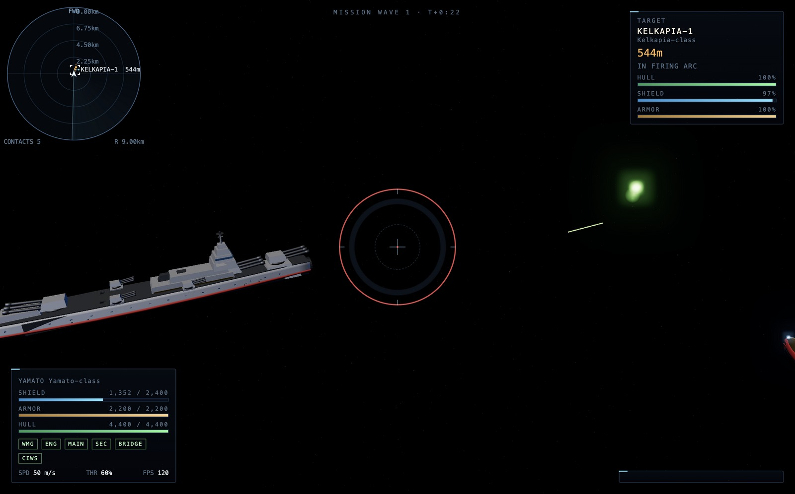

# YAMATO FLEET 2199

**宇宙戦艦ヤマト 艦隊戦 — 技術デモ / a technical demo of space capital-ship combat**

A playable browser demo of fleet combat inspired by *Space Battleship Yamato
2199 / 2202 / 2205*. You command the Earth Federation battleship **Yamato
(BBY-01)** against Garmillas and Bolar Federation fleets across three waves.

It is an **original fan tribute**: every mesh is generated by this project's own
Python tool, and every sound is synthesised at runtime. No art, audio, model or
texture from any third party — free, open or otherwise — is included.



---

## Quick start

```bash
cd yamato-fleet

# 1. (optional) regenerate the fleet geometry — deterministic, no dependencies
python3 tools/gen_models.py --out assets/models
python3 tools/validate_models.py assets/models

# 2. serve it (native ES modules + fetch() need http://, not file://)
node tools/serve.mjs
#   → http://127.0.0.1:8177/
```

Then open **http://127.0.0.1:8177/** and click the canvas to capture the mouse.

No build step, no bundler, no `npm install`. The only runtime dependency is a
vendored copy of [three.js](https://threejs.org) r160 (MIT) in `vendor/three/`,
resolved through the import map in `index.html`.

Requirements: Node ≥ 20 (only to run the static server and the tests), Python ≥ 3.8
(only to regenerate assets), and a WebGL2 browser.

> **The demo runs even without generated assets.** If
> `assets/models/manifest.json` is missing or mid-regeneration, the game
> synthesises the fleet description from `CONFIG` and renders placeholder
> geometry — every weapon, hardpoint and subsystem still works. This is
> deliberate: a missing asset must never white-screen the demo.

---

## Music

The score is **synthesised at runtime** by `src/core/music.js` from oscillators —
four cues (boot, battle, victory, defeat) picked from the match state, sharing
the audio engine's context and master bus so the mute key and
`CONFIG.audio.master` apply to music as well. It is original and needs no files,
no network, and no licence.

If you would rather hear real recordings, `tools/fetch_audio.mjs` downloads
verified **public domain / CC0 / CC BY** tracks into `assets/audio/`, which is
gitignored so nothing it fetches can enter the repository:

```bash
node tools/fetch_audio.mjs --list     # the catalogue, with every licence
node tools/fetch_audio.mjs            # download what your network allows
```

It sniffs every download for a real audio container before writing, so an HTML
error page never lands as an `.ogg`, and it writes a `manifest.json` that the
music engine prefers over the synthesised score when present. **CC BY entries
carry an obligation** — the required credit is recorded in
[THIRD_PARTY_AUDIO.md](THIRD_PARTY_AUDIO.md) and travels in the manifest.

`assets/audio/uncleared/` is for copyrighted material downloaded for private
local evaluation only. It is gitignored, it is never distributed, and the demo
falls back to the synthesised score wherever it is absent. See
[THIRD_PARTY_AUDIO.md](THIRD_PARTY_AUDIO.md).

---

## Controls

| Key | Action |
|---|---|
| `W` / `S` | Throttle up / down (throttle holds where you leave it) |
| `A` / `D` | Yaw left / right |
| `I` / `K` | Pitch up / down |
| `Q` / `E` | Roll left / right |
| `Shift` | Boost (2× top speed) |
| `X` | Brake |
| `Space` | Main battery — shock cannon (3 turrets, 3-shell volley) |
| `G` | Secondary battery |
| `F` | Torpedo salvo (4 torpedoes, homing) |
| `R` | **Wave motion gun** — hold to charge, release to fire |
| `T` | **Toggle firing mode** — `MANUAL` (手動射撃) or `AUTO` (自動射撃) |
| `B` | Cycle which weapon's firing arc the HUD draws and leads with |
| `Tab` | Cycle target |
| `C` | Cycle camera (chase / orbit / cinematic) |
| `Z` | Radar zoom |
| `P` | Pause · `M` Mute |
| `Enter` | Restart after victory/defeat |

**Firing modes.** In `MANUAL` you pull the trigger (`Space` / `G` / `F`, hold `R`).
In `AUTO` the guns fire themselves whenever a locked target is inside the
weapon's arc and range, and the wave motion gun charges and releases on its own
once it is fully charged and aligned. Manual keys still work as an override in
either mode.

**Reading the firing-arc indicator.** A translucent cone is projected from your
bow showing the selected weapon's traverse arc — green when the locked target is
inside it, amber when it is not. A 40-segment ring is drawn on your ship's plane
at that weapon's maximum range (plus the wave motion gun's far ring for scale),
so "can I reach it" is a circle you can see rather than a number you have to
remember. Each traversable mount also gets a tick around the reticle showing its
current bearing, and the weapons panel reports `n/N BEARING` per weapon — so a
trigger pull that does nothing reads as an ARC problem rather than a bug.

The drawn cone is clamped to a 52° fan by `CONFIG.ui.arcMaxDisplayDeg`; a real
150° traverse fan would cover the screen and read as a flat wash instead of a
cone. The TRUE arc is always reported numerically, so the clamp can never hide
whether a shot will actually leave the barrel.

Add `?debug=1` to the URL for verbose event logging and a shortened wave-motion
gun charge (useful when testing).

---

## How it plays

- **The wave motion gun is the whole game.** It has a **±3° firing arc** — the
  bow must be pointed at the target — an 8 s charge and a 60 s cooldown. It
  destroys a cruiser outright, guts a battleship to ~40%, and *cannot* one-shot
  you. Its cost is the aim, not the cooldown.
- **A 200 m standoff band.** Your shock cannon reaches 2000 m; Garmillas beams
  reach 1800 m. That gap is what makes "back off and let the shields recharge" a
  real tactic rather than a fantasy, and it rewards the Yamato's speed.
- **Three layers of defence.** Shield → armor → hull. Only the shield
  regenerates, so armor loss is permanent pressure that accumulates across waves.
- **Subsystems can be knocked out.** 15% of every *hull-layer* hit is redirected
  to one random surviving subsystem — the wave motion gun, an engine, a turret,
  the bridge. Shields holding means subsystems are safe, which is a real reason
  to keep them up.
- **You are not alone.** UNCF escorts (Yukikaze destroyers, Kirishima and
  Andromeda) fight alongside you. They soak fire, and they die.

| Wave | Opposing force |
|---|---|
| 1 | 3 × Garmillas Kelkapia-class cruisers |
| 2 | 1 × Gaiderol-class battleship + 1 × Kelkapia |
| 3 | Desler's 638 m flagship + Bolar carrier + 2 × Kelkapia |

---

## Architecture

No bundler. Native ES modules, one HTML import map, a fixed-timestep simulation.

```
index.html               page shell, import map, boot screen
src/main.js              bootstrap, world object, sim loop, waves, player control
src/core/
  config.js              ← THE balance source of truth (every tunable number)
  scene.js               renderer, bloom, starfield, camera rig
  assets.js              manifest + OBJ/MTL loading, hardpoint resolution
  objparse.js            dependency-free OBJ/MTL parser (pure, unit-tested)
  fallback_manifest.js   fleet description synthesised from CONFIG
  input.js  math.js  rng.js
src/entities/
  ship.js                flight model, damage layering, subsystems, steering
  projectile.js          pooled shells/beams/missiles/torpedoes, swept collision
  effects.js             particles, star bursts, shockwaves, the wave motion beam
src/weapons/weapons.js   WEAPONS table, firing, charge, point defence
src/ai/fleetai.js        formation keeping, target selection, fire discipline
src/ui/hud.js            DOM HUD; src/ui/radar.js  tactical plot
src/core/audio.js        100% procedural WebAudio synthesis
tools/gen_models.py      procedural ship modeller → OBJ + MTL + manifest.json
tools/validate_models.py asserts the asset contract
tools/serve.mjs          dependency-free static server
```

**Design rules the code actually follows**

- `CONFIG` owns every balance number. No other module hardcodes damage, range,
  speed or ship id.
- `Ship.update()` is the single authority for attitude and velocity. The player
  and the AI both write the same `ship.controls` bag; nothing else touches the
  transform, so nothing fights over it.
- The weapon table is data, not code: `perMountDPS = damage × salvo ÷ cooldown`,
  `shipDPS = mounts[weaponId] × perMountDPS`.
- Fast projectiles use a **swept** segment-vs-bounding-sphere test, so a
  4000 m/s wave motion gun bolt (66 m per frame) cannot tunnel through a hull.
- Teammate modules are imported **optionally**; a missing file degrades to a
  no-op fallback instead of a white screen.

---

## Asset policy

> **YAMATO FLEET 2199 ships no third-party art or audio.** Every mesh is
> generated by our own Python tool (`tools/gen_models.py`) from parametric
> primitives, and every sound is synthesised at runtime by `src/core/audio.js`
> from oscillators and noise buffers. No model, texture, sprite, sound file,
> font, or motion data from any third party — free, open, or otherwise — is
> included in this repository. Research informed shapes, palettes and numbers
> only.

The generator is deterministic (fixed seeds), uses only the Python standard
library plus `numpy` if present, and emits the contract in `docs/SPEC.md` §5:
bow toward −Z, up +Y, origin at the ship's centre, one OBJ + MTL per ship, `g`
groups from a fixed list, materials from a fixed palette, under 12 000 triangles.
`tools/validate_models.py` asserts all of it, and a unit test asserts that every
file under `assets/models/` is accounted for by `manifest.json` — which turns
"we ship no third-party art" from a promise into something checkable.

*Blender's `bpy` was deliberately avoided:* published `bpy` scripts must be
GPL-compatible, which would put GPL code in an otherwise MIT repository.

---

## Research

The demo's numbers and look are not invented. Four research documents sit behind
them, each with sources:

| Document | What it drives |
|---|---|
| [`docs/research/01-yamato-ships.md`](docs/research/01-yamato-ships.md) | Canon ship specs, silhouettes, palettes → the 3D models |
| [`docs/research/02-combat-mechanics.md`](docs/research/02-combat-mechanics.md) | The whole balance table, TTK targets, AI doctrine → `CONFIG` |
| [`docs/research/03-reference-video-analysis.md`](docs/research/03-reference-video-analysis.md) | Frame-measured colours and effects → the renderer |
| [`docs/research/04-asset-licensing.md`](docs/research/04-asset-licensing.md) | Licensing survey → the asset policy above |

Three findings from the reference-video analysis are load-bearing, and all three
came from measuring pixels rather than eyeballing:

1. **Space is literally black.** 51–91% of every reference frame is `#000000` —
   no nebula, no skybox. Black background + flat emissive beams + bloom *is* the
   look, and it costs nothing.
2. **Explosions are flat pure-white star sprites** — 16 732 pixels of exactly
   `#ffffff`, no orange, no fireball, no smoke, ~0.4 s fade. One additive quad.
3. **Bolar weapons are desaturated green comets** (hue 118–128° but saturation
   only 0.26–0.46), not neon beams. That single change is what makes wave 3 read
   as a different enemy.

Anchoring the balance: the shock cannon's **6 × ship length = 2000 m** range is
the largest multiple at which a 333 m hull is still a legible object on a
third-person chase camera. The historical *Yamato*'s 46 cm guns reached ~126 × L,
at which the enemy is a sub-pixel dot and there is no demo.

---

## Verification

```bash
node --test tests/            # pure-logic unit tests
node tools/serve.mjs          # then browser end-to-end checks
```

`docs/VERIFY.md` holds the pass/fail checklist, the evidence, and the known gaps.
`docs/PLAYTEST.md` holds the measured playtest numbers from scripted
fast-forward runs (a full 347-second battle is exercised deterministically via
the `world.tick(dt)` hook rather than by waiting in real time).

`window.__YAMATO__` exposes the live world object for debugging and automated
verification (`ships`, `projectiles`, `effects`, `player`, `state`, `waveIndex`,
`tick`, `startWave`, `nearestEnemy`).

---

## Known limitations

- **Single scenario.** Three waves, one player ship, no campaign or progression.
- **Sphere collision.** Ships and projectiles use bounding spheres; there is no
  mesh-accurate hit detection.
- **Turret traverse is instantaneous.** `arcDeg` limits *whether* a mount can
  bear, but mounts do not visibly rotate toward the target yet.
- **Radar zoom (`Z`) is wired to the key map but the radar currently auto-ranges.**
- **Audio is functional, not scored** — there is no music track, by design.
- **Escort AI is deliberately simple.** It closes, holds range and fires; it does
  not coordinate focus fire with the player.

---

## Licence

Project code: MIT. three.js is MIT and vendored under `vendor/three/LICENSE`.

*Space Battleship Yamato* is a copyrighted work owned by its rights holders.
This is an unaffiliated, non-commercial fan tribute built from original geometry
and original audio; it reproduces no assets from the series or from any other
game.
